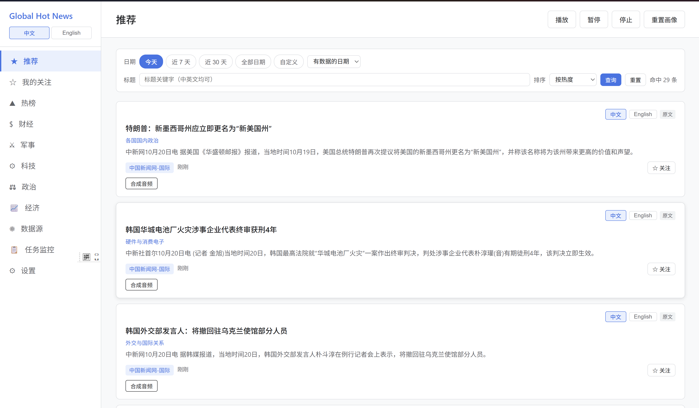
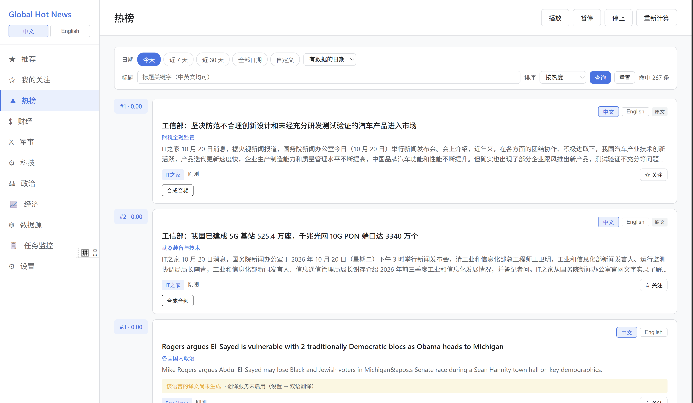
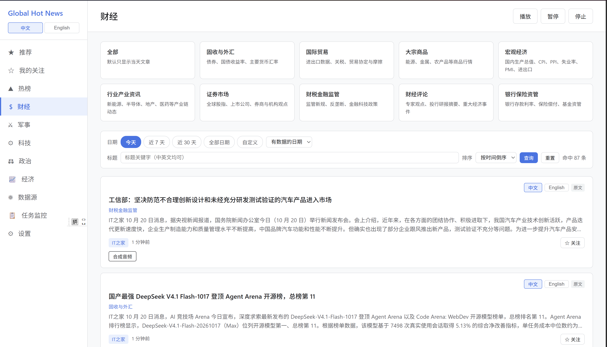
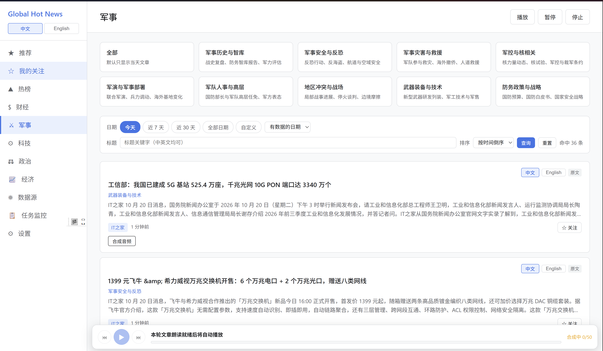
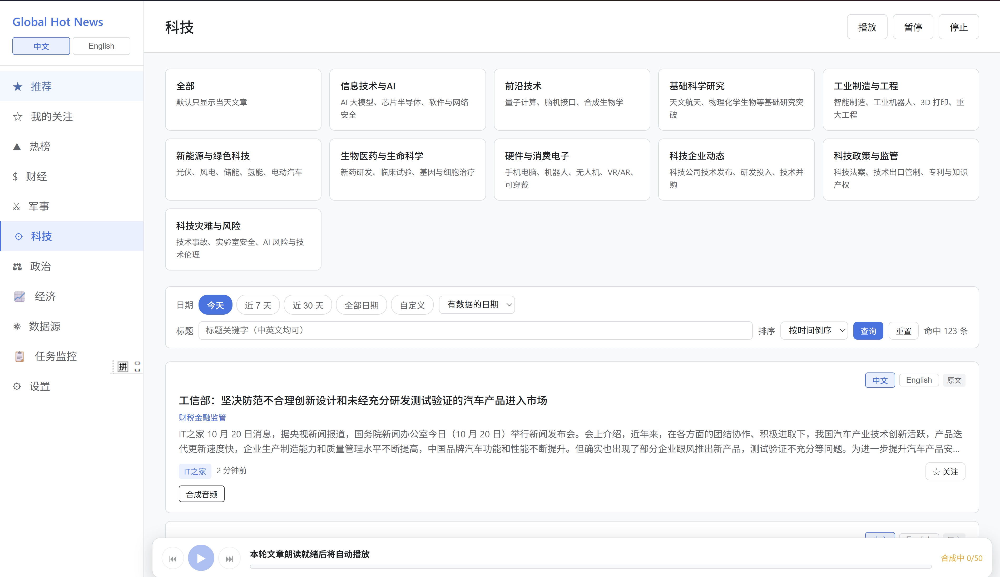
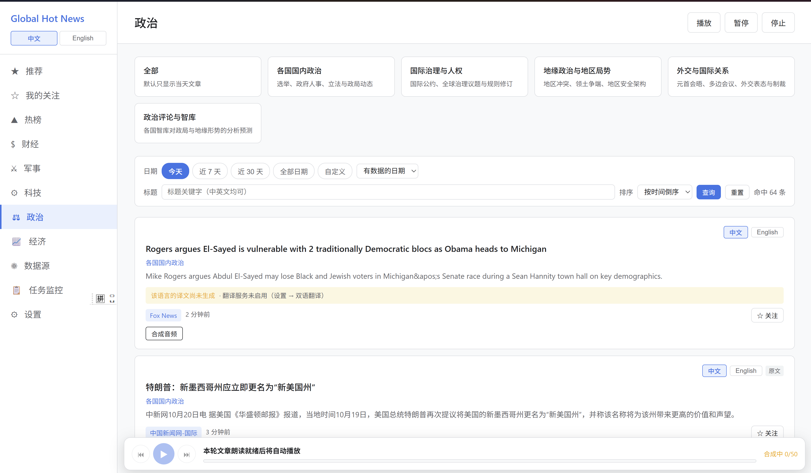
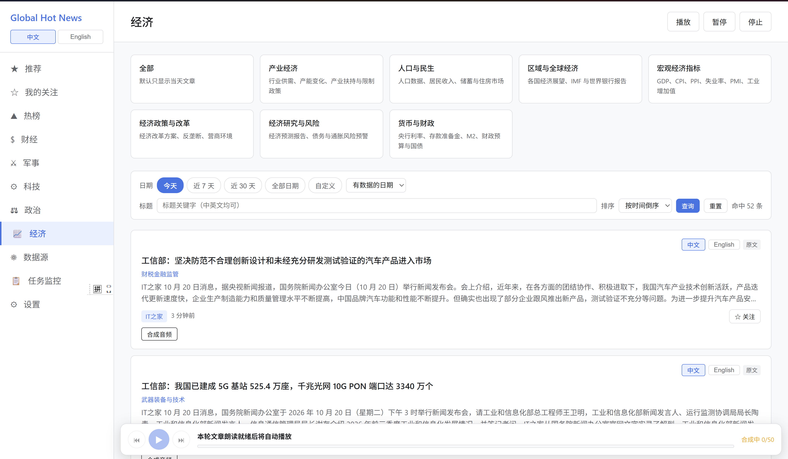
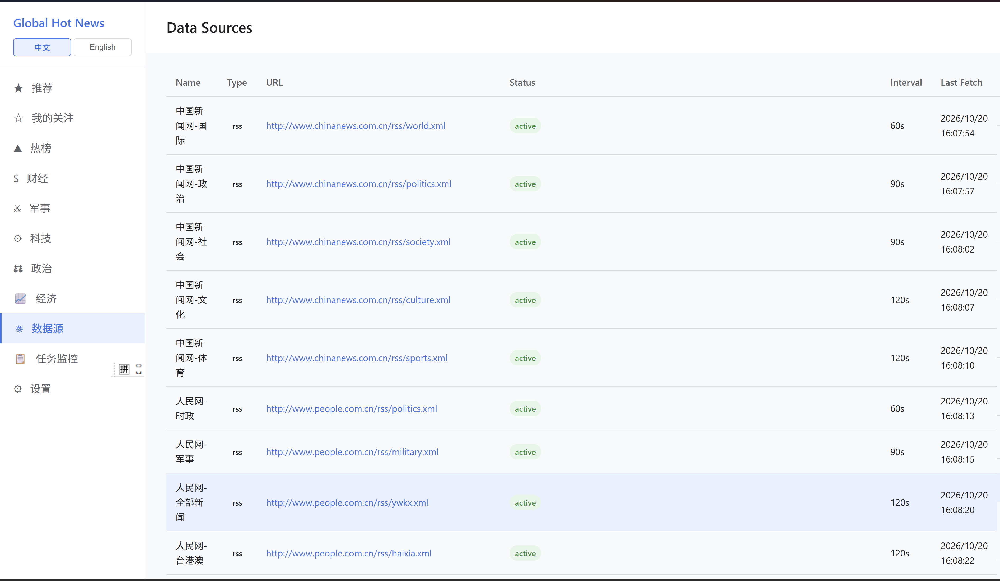
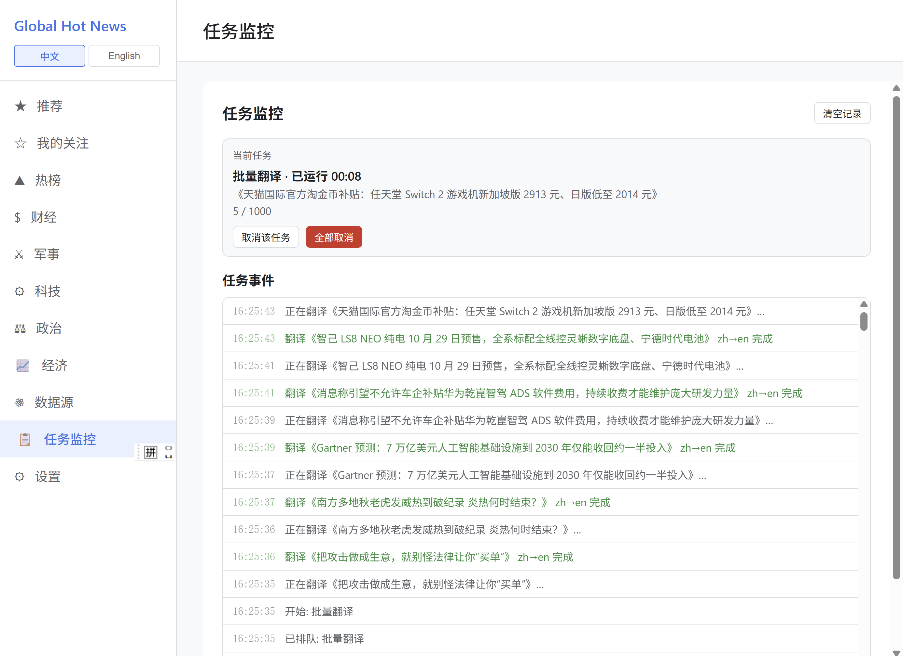
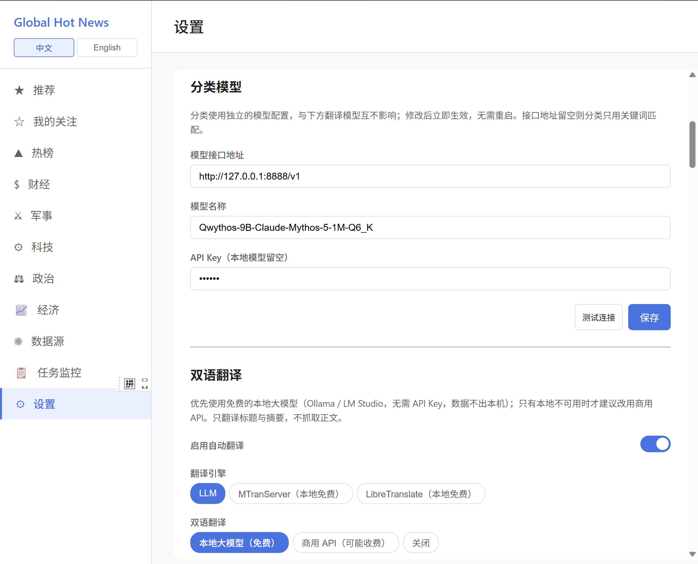

# Global Hot News｜全球热点资讯

Windows 本地单机桌面资讯聚合应用：抓取全球公开 RSS 源，按板块分类聚合，本地画像推荐，
支持中英双语生成与语音播报。**所有数据只存本机，不上传、不对外提供服务。**

> Personal, local-only news aggregator for Windows. Go + Wails + Angular desktop app that
> collects public RSS feeds, classifies them, recommends by local reading profile, and can
> narrate articles with local TTS. Nothing leaves your machine.

## 界面预览

| 推荐 | 热榜 | 财经 |
| --- | --- | --- |
|  |  |  |

| 军事 | 科技 | 政治 |
| --- | --- | --- |
|  |  |  |

| 经济 | 数据源 | 任务监控 | 设置 |
| --- | --- | --- | --- |
|  |  |  |  |

## 功能特性

- **多板块聚合**：推荐、我的关注、热榜、财经、军事、科技、政治、经济，以及更多二级分类
- **本地画像推荐**：基于阅读/停留/关注行为在本机打分排序，不建云端用户模型
- **中英双语生成**：标题与摘要可自动互译，引擎可选本地大模型（Ollama / LM Studio）、
  MTransServer、LibreTranslate 或商用 API；只翻译标题摘要，不抓正文
- **语音播报**：抓取完成后异步生成本地 TTS 音频，播放器常驻底栏，支持自动连播
  （由 Python 的 `edge-tts` 驱动，需 `>=7.3.1`）
- **数据源管理**：增删改查、连通性测试、手动抓取、启停，内置国内可访问源种子数据
- **任务监控**：批量翻译等长任务的进度、事件流与取消控制
- **合规内建**：遵守 robots.txt、限速加随机抖动、按规则过滤评论/深度报道/图片版权内容，
  原文以外链方式打开
- **去重归一**：跨源标题归一化与指纹去重，避免同稿多源刷屏
- **界面中/英切换**、分类与抓取频率等本地化设置项

## 技术栈

| 层 | 选型 |
| --- | --- |
| 桌面壳 | Wails v2.12（进程内绑定，无对外 HTTP 服务） |
| 后端 | Go 1.22 + Gin + GORM + SQLite（go-sqlite3，需 CGO） |
| 前端 | Angular 22 + TypeScript 6 + RxJS 7 |
| 打包 | `wails build -nsis`（自带 WebView2 bootstrapper） |
| 辅助 | Python 3 RSS 桥接服务（替代 Docker 版 RSSHub） |

## 目录结构

```
backend/                 Go 后端与 Wails 配置
  cmd/app/               程序入口（go:embed 前端产物）
  internal/              config / models / repository / service / bindings / router
    service/             collector, parser, filter, dedup, classifier, recommend,
                         hotrank, follow, news, translator, tts, llmqueue, setting, robots
  build/windows/         图标、manifest 与安装器资源
frontend/angular-app/    Angular 前端（构建产物直接输出到 backend/frontend_dist）
tools/                   本地 RSS 桥接：news-rss-bridge(1200) / china-finance-rss(8053)
docs/                    需求、架构设计、审计与实现说明
build-desktop.bat        一键构建 + 打包脚本
```

## 环境要求

- Windows 10/11 x64，WebView2（安装器会自动引导安装）
- Go 1.22+、Node.js 18+、`go install github.com/wailsapp/wails/v2/cmd/wails@latest`
- C 编译器（CGO，`go-sqlite3` 需要）：MSYS2 `gcc`，脚本会自动探测
  `C:\msys64\ucrt64\bin`、`C:\msys64\mingw64\bin` 与 WinGet 目录
- Python 3.10+（仅运行 RSS 桥接与语音播报时需要；语音播报要求 `edge-tts>=7.3.1`，
  更早的版本仍在使用已被微软废弃的 v1 `Sec-MS-GEC` 令牌，握手会被直接 403 拒绝）

## 构建与运行

```bat
build-desktop.bat
```

脚本依次完成：Angular 构建 → 校验嵌入产物 → `wails build` → `wails build -nsis`。
产物在 `backend/build/bin/`：

- `GlobalHotNews.exe` 绿色版可执行文件
- `global-hot-news-amd64-installer.exe` 安装包（含 WebView2 bootstrapper）

开发模式：

```bat
cd frontend\angular-app && npm install
cd ..\..\backend && wails dev
```

若 Wails CLI 提示模块根目录缺少 `main.go`，按 `build-desktop.bat` 的做法把
`backend\cmd\app\main.go` 暂存到 `backend\main.go`（真实入口在 `cmd\app`，构建结束会还原）。

## 本地 RSS 桥接

部分国内源没有标准 RSS，用 `tools/` 下的轻量 Python 服务补齐，后端 source URL 与 RSSHub 一致：

```bat
tools\news-rss-bridge\start-bridge.bat      rem  http://localhost:1200/    一财/知乎/财新/新浪/格隆汇等
tools\china-finance-rss\start-bridge.bat    rem  http://localhost:8053/    财联社/东财/同花顺/金十/见闻
```

`news-rss-bridge` 只用 Python 标准库，`china-finance-rss` 首次运行前执行
`pip install -r tools\china-finance-rss\requirements.txt`；
`stop-bridge.bat` 停止服务，`python server.py` 可前台调试。

## 数据与隐私

- 运行数据全部位于 `%APPDATA%\GlobalHotNews\`：`global_hotnews.db`（SQLite）、
  `app.log`、`media\tts\*.mp3`
- 你在设置里填写的模型地址与 API Key 只写入本机数据库，代码仓库与运行时均不外发
- 应用只监听 Wails 进程内绑定，不开放局域网端口；删除该目录即可清除全部本地记录
- 本仓库不含任何使用记录、Cookie 或密钥，截图中的 Key 输入框为掩码显示

## 测试

```bat
cd backend && go test ./...
cd backend\tests\playwright && npm install && npx playwright test
```

## 许可

仅限**个人学习与教育**用途，任何商业用途须事先获得作者书面授权，详见 [LICENSE](LICENSE)。
不得用于绕过 robots.txt 或技术保护措施、高频请求第三方服务器。
